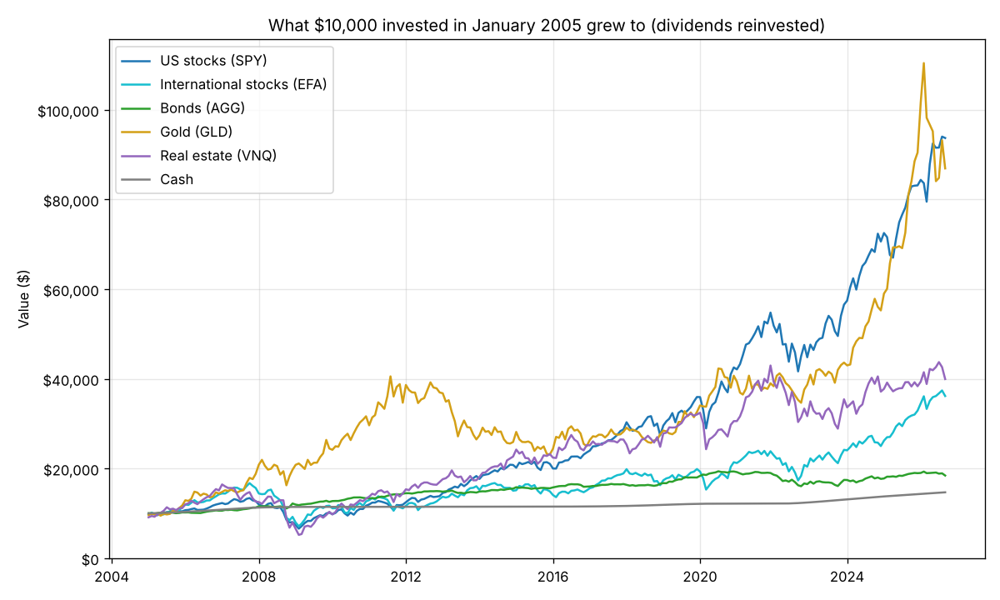
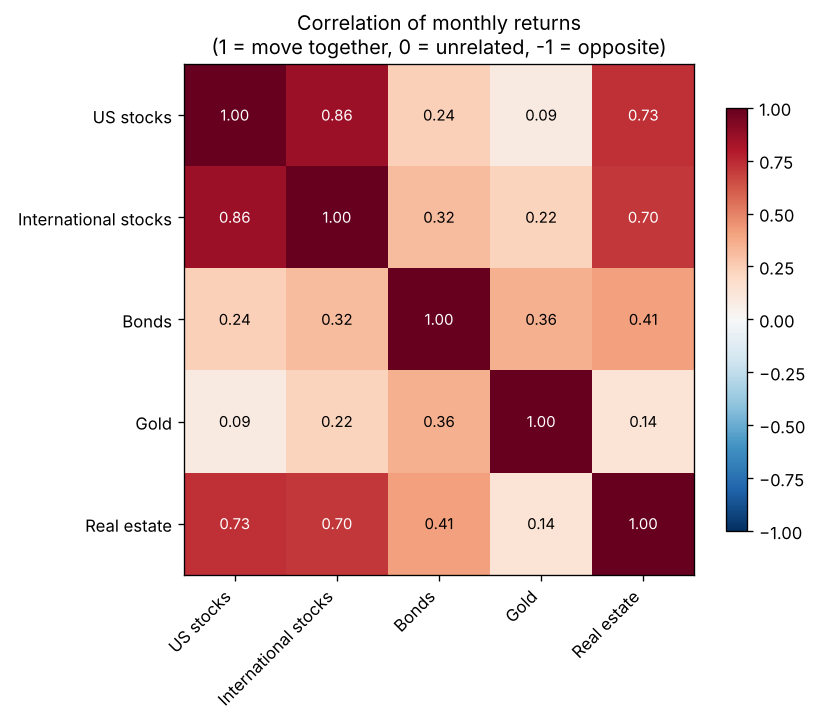
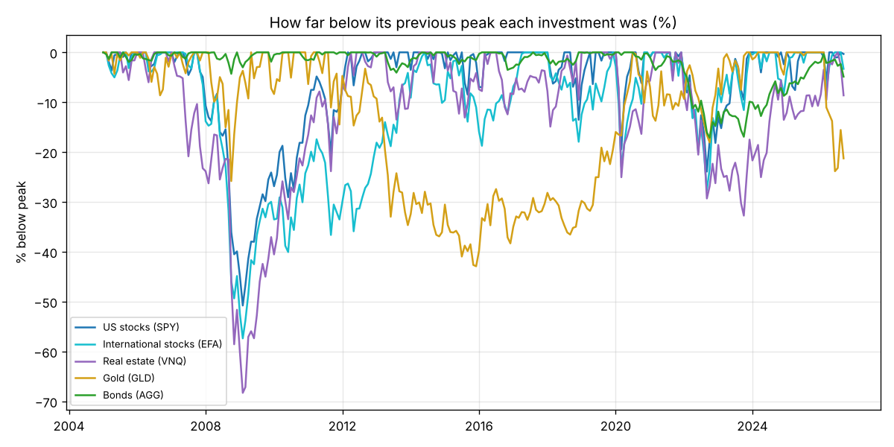
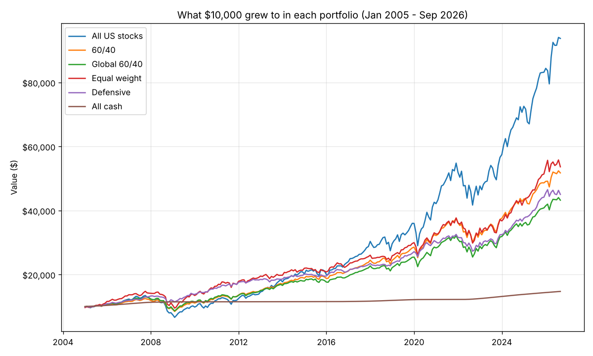
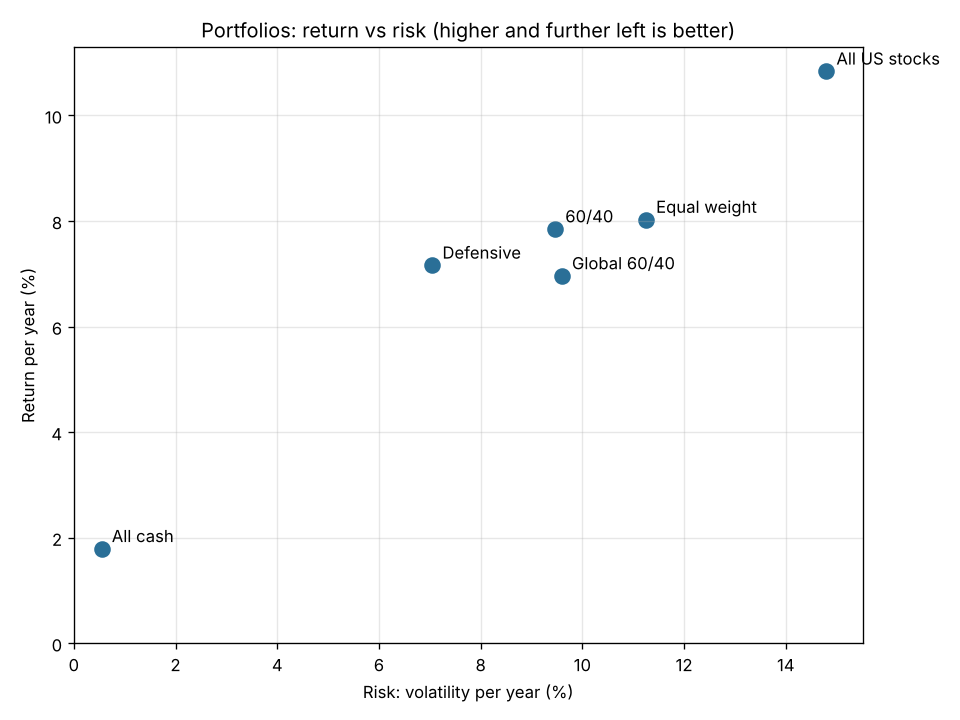
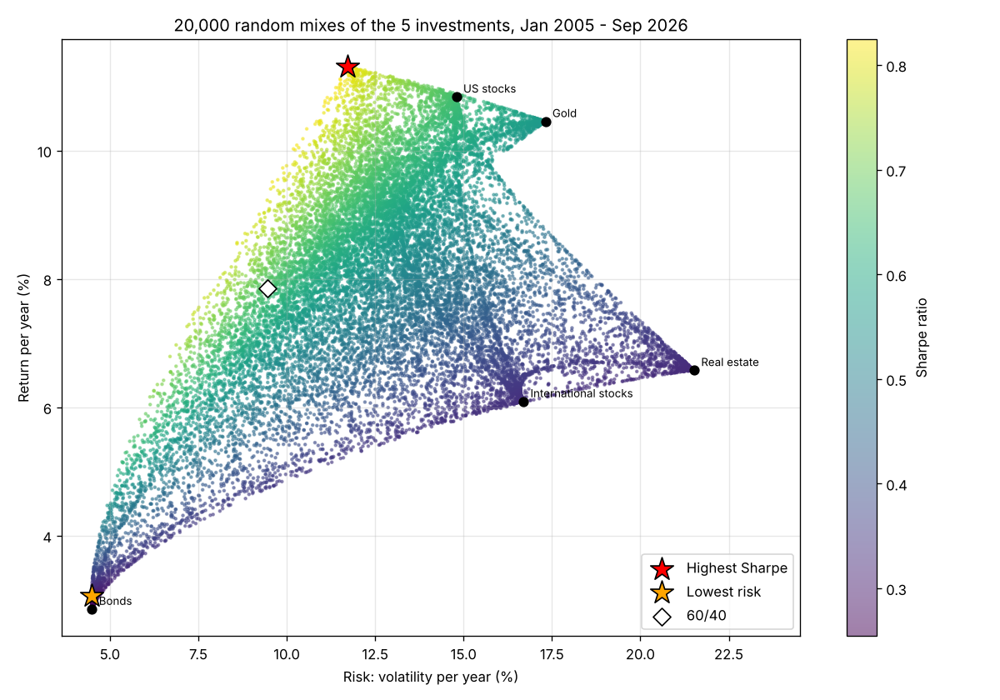

# Multi-Asset Portfolio Study


**Question:** a long-term investor can put money into stocks, bonds, gold, real estate or cash. How should they split it, and how did each mix hold up in crashes like 2008 and 2020?

This project answers that with **real market data**: 21¾ years of monthly returns, from January 2005 to September 2026. The period includes three crashes: the 2008 financial crisis, COVID in 2020 and the 2022 interest-rate shock.

**Tools:** Python · pandas · NumPy · matplotlib

> New to investing? Read [Key terms explained](#key-terms-explained) first. Every idea used here is explained in one or two sentences.

---

## Key results at a glance

1. **US stocks grew the most, but fell the hardest.** $10,000 in US stocks became $93,738, about 10.8% a year. But it lost 50.8% from its peak in the 2008 crisis.
2. **Mixing makes the ride much smoother.** The classic 60/40 portfolio (60% stocks, 40% bonds) earned 7.8% a year with about a third less risk. Its worst fall was 32%, compared with 51% for stocks alone.
3. **Gold and bonds were the best "shock absorbers".** Gold rose 17.8% during the 2008 crisis while stocks fell 50.8%. Gold's correlation with US stocks was close to zero (0.09).
4. **Bonds failed in 2022.** When interest rates rose fast, bonds fell 14.4% at the same time as stocks. Diversification doesn't protect you in every crash.
5. **The "best" portfolio is only best in hindsight.** The mix with the best return for its risk over 2005–2015 then did *worse* than a simple 60/40 over 2016–2026: 4.0% a year compared with 9.6%.

---

## The data

| Asset | What it holds | Fund (ETF) used |
|---|---|---|
| US stocks | The 500 biggest US companies (S&P 500) | SPY |
| International stocks | Big companies in Europe, Japan, Australia and more | EFA |
| Bonds | US government and company bonds | AGG |
| Gold | Physical gold | GLD |
| Real estate | REITs: companies that own buildings and collect rent | VNQ |
| Cash | 3-month US Treasury bills | rate from FRED (TB3MS) |

- **Prices:** from Yahoo Finance, adjusted for dividends. Returns are **total returns**: they include the dividends and interest each fund paid, after the fund's small yearly fee. They are in US dollars. The UAE dirham is pegged to the dollar, so the results are the same for an investor in AED.
- **Checked against published figures:** the data gives −36.8% for US stocks in 2008 and −13.0% for bonds in 2022. Both match the funds' published yearly returns.
- **Why ETFs?** They are real funds that anyone could have bought, so the results show what an investor could actually have earned, not a theoretical index.

---

## Key terms explained

| Term | What it means |
|---|---|
| **Asset class** | A type of investment: stocks, bonds, gold, real estate, cash. |
| **Portfolio** | Your whole mix of investments, e.g. 60% stocks and 40% bonds. |
| **Return per year** | The average yearly growth rate (CAGR). 7% a year doubles your money in about 10 years. |
| **Volatility (risk)** | How much returns jump up and down in a year. Higher = a bumpier ride. |
| **Sharpe ratio** | (Return − cash return) ÷ volatility = extra reward per unit of risk. Higher is better. |
| **Max drawdown** | The biggest fall from a peak to a bottom. −50% means at the worst point you had lost half. |
| **Correlation** | How much two investments move together, from −1 to 1. 1 = always together; 0 = unrelated. Low correlation is what makes mixing useful. |
| **Rebalancing** | Resetting the mix back to its targets. Here this is done every month. |
| **Backtest** | Testing a strategy on past data to see how it would have done. |
| **Efficient frontier** | The set of mixes giving the highest return for each level of risk. |
| **Hindsight bias** | Picking the "best" choice after already seeing what happened. It looks great on paper but often fails in the future. |

---

## Step 2: Each asset on its own



| Asset | Return / yr | Volatility | Sharpe | Max drawdown | Best year | Worst year | $10,000 became |
|---|---|---|---|---|---|---|---|
| US stocks | 10.8% | 14.8% | 0.65 | −50.8% | +32.3% (2013) | −36.8% (2008) | $93,738 |
| Gold | 10.5% | 17.3% | 0.56 | −42.9% | +63.7% (2025) | −28.3% (2013) | $86,950 |
| International stocks | 6.1% | 16.7% | 0.33 | −57.4% | +31.5% (2025) | −41.0% (2008) | $36,190 |
| Real estate | 6.6% | 21.5% | 0.32 | −68.3% | +40.5% (2021) | −37.0% (2008) | $39,977 |
| Bonds | 2.9% | 4.5% | 0.25 | −17.1% | +8.5% (2019) | −13.0% (2022) | $18,458 |
| Cash | 1.8% | 0.6% | – | 0.0% | +5.2% (2023) | 0.0% (2014) | $14,716 |

**How to read this:** US stocks grew 10.8% a year, but in the worst stretch they were 50.8% below their previous high. Bonds grew only 2.9% a year, but never fell more than 17.1%.

**What it shows**

- **Higher return came with bigger falls.** Real estate was the riskiest: it lost 68% at its worst, during 2007–2009.
- **Gold had two very different decades.** It fell 43% from 2011 to 2015, then rose 63.7% in 2025 alone.
- **US stocks beat international stocks** by almost 5 percentage points a year in this period. That won't necessarily repeat.

### How they move together



US and international stocks move closely together (0.86), and real estate mostly follows stocks too (0.73). **Gold (0.09) and bonds (0.24) barely follow stocks.** That is why they help most in a mix.

### How they did in crashes

| Crash | US stocks | International stocks | Bonds | Gold | Real estate | Cash |
|---|---|---|---|---|---|---|
| 2008 financial crisis (Nov 2007 – Feb 2009) | −50.8% | −57.4% | +6.5% | +17.8% | −64.6% | +1.9% |
| 2020 COVID crash (Feb – Mar 2020) | −19.4% | −20.8% | +1.0% | −0.9% | −25.1% | +0.2% |
| 2022 interest-rate shock (Jan – Sep 2022) | −23.9% | −27.2% | **−14.4%** | −9.5% | −29.3% | +1.0% |



---

## Step 3: Building portfolios

Six portfolios were tested from January 2005 to September 2026, rebalanced every month:

| Portfolio | Mix | Return / yr | Volatility | Sharpe | Max drawdown | $10,000 became |
|---|---|---|---|---|---|---|
| All US stocks | 100% US stocks | 10.8% | 14.8% | 0.65 | −50.8% | $93,738 |
| 60/40 | 60% US stocks, 40% bonds | 7.8% | 9.5% | 0.66 | −32.3% | $51,736 |
| Global 60/40 | 40% US, 20% international stocks, 40% bonds | 7.0% | 9.6% | 0.57 | −34.1% | $43,212 |
| Equal weight | 20% in each of the 5 assets | 8.0% | 11.3% | 0.59 | −35.7% | $53,640 |
| Defensive | 30% US stocks, 50% bonds, 20% gold | 7.2% | 7.1% | 0.77 | −16.2% | $45,015 |
| All cash | 100% T-bills | 1.8% | 0.6% | – | 0.0% | $14,716 |




**What it shows**

- **The trade-off is real.** All stocks ended with the most money, but with half the value gone at the worst point. Few people can hold on through that.
- **Defensive had the best return for its risk** (Sharpe 0.77). In 2008 it lost only 7.5%, against 36.8% for all stocks. Part of that is gold's exceptional 2025, so don't expect it to repeat.
- **Adding international stocks lowered returns** (Global 60/40 vs 60/40), because US stocks did unusually well in this period.

| Crash | All US stocks | 60/40 | Global 60/40 | Equal weight | Defensive |
|---|---|---|---|---|---|
| 2008 financial crisis | −50.8% | −32.3% | −34.1% | −35.7% | −12.5% |
| 2020 COVID crash | −19.4% | −11.5% | −11.8% | −13.3% | −5.7% |
| 2022 interest-rate shock | −23.9% | −20.0% | −20.8% | −20.9% | −16.2% |

---

## Step 4: The efficient frontier, and the hindsight trap

**Part A.** I tried 20,000 random mixes of the five assets (no borrowing, all weights positive). The upper-left edge of the cloud is the efficient frontier.



| Mix | Weights | Return / yr | Volatility | Sharpe |
|---|---|---|---|---|
| ★ Highest Sharpe ratio | 58% US stocks, 42% gold | 11.3% | 11.7% | 0.82 |
| ★ Lowest risk | 98% bonds, 2% US stocks | 3.1% | 4.5% | 0.30 |

Looking back, 58% stocks and 42% gold would have beaten every single asset: more return than stocks alone, with less risk.

**Part B: would you have known?** I repeated the search using only 2005–2015, then checked how that "best" mix did over the next 10 years:

| Portfolio | 2005–2015 return / yr | 2005–2015 Sharpe | 2016–2026 return / yr | 2016–2026 Sharpe |
|---|---|---|---|---|
| Best mix chosen using 2005–2015 (81% bonds, 14% US stocks, 5% gold) | 4.9% | 0.87 | 4.0% | 0.32 |
| Simple 60/40 | 6.1% | 0.57 | 9.6% | 0.75 |

**Lesson:** the mix that looked best in 2015 was the wrong one for the next decade, and the simple 60/40 did far better. The past winner depends on what happened in that period. 2005–2015 included the 2008 crash, so bonds looked great: bonds earned 4.1% a year and US stocks 7.0%. In 2016–2026 it flipped: US stocks earned 14.9% a year and bonds only 1.6%. This is why professional investors are careful with "optimised" portfolios and test them on data they haven't seen.

---

## How the project works

```
data/prices_monthly.csv  ─┐
data/tbill_3month.csv    ─┤   (step 1 downloads these; they are already included)
                          ▼
                    src/helpers.py     loads the data, measures return / risk / Sharpe / drawdown
                          │
     ┌────────────────────┼────────────────────────┐
     ▼                    ▼                        ▼
 step 2               step 3                    step 4
 compare assets       build portfolios          efficient frontier + hindsight test
     └────────────────────┴────────────────────────┘
                          ▼
              results/*.csv  and  images/*.png
```

| Folder / file | What's inside |
|---|---|
| `data/` | Monthly prices of the 5 ETFs and the T-bill rate |
| `src/helpers.py` | **Start here.** Small functions for every measure, each explained |
| `src/step1_download_data.py` | Downloads fresh data (optional) |
| `src/step2_compare_assets.py` | Step 2 above |
| `src/step3_build_portfolios.py` | Step 3 above. Change the `PORTFOLIOS` list to test your own mixes |
| `src/step4_efficient_frontier.py` | Step 4 above |
| `results/` | Every table in this README, as CSV files |
| `images/` | Every chart in this README |
| `tests/` | Automatic checks GitHub runs after each change (the green "check" badge) |

## How to run it yourself

1. Install [Python](https://www.python.org/downloads/) (3.10 or newer).
2. Open a terminal and run:

```bash
git clone https://github.com/ShaikhaKhaledAlz/multi-asset-portfolio.git
cd multi-asset-portfolio
pip install -r requirements.txt

python src/step2_compare_assets.py      # each asset on its own
python src/step3_build_portfolios.py    # portfolios and crashes
python src/step4_efficient_frontier.py  # efficient frontier and hindsight test
```

**Try it yourself:** open `src/step3_build_portfolios.py` and add your own mix, for example `"My mix": {"SPY": 0.5, "GLD": 0.3, "AGG": 0.2}`. Run it again and compare.

**To update the data:** run `python src/step1_download_data.py`, then change `LAST_MONTH` in `src/helpers.py` to the last full month.

---

## Limitations

- **One period of history.** 2005–2026 was very good for US stocks and, recently, for gold. Different decades give different winners, as Step 4 shows.
- **No costs or taxes.** Monthly rebalancing would cost a little in trading fees. Taxes depend on where you live.
- **US-dollar view.** All returns are in USD, which is the same as AED because of the peg. An investor using another currency would see different results.
- **Volatility isn't the only risk.** It treats ups and downs equally and can miss rare, extreme events. That's why max drawdown and crash returns are shown too.
- **Monthly data.** Falls within a month (e.g. the worst days of March 2020) are slightly understated.

## Next steps

- Add Gulf assets, for example UAE stocks or Dubai property from my [Dubai real estate project](https://github.com/ShaikhaKhaledAlz/dubai-real-estate)
- Test rebalancing once a year instead of monthly, and include trading costs
- Rolling 10-year windows: how often did 60/40 beat 100% stocks?

---

*Built by Shaikha as a portfolio project in investment analysis.*
*Data: Yahoo Finance (ETF prices) and Federal Reserve Bank of St. Louis, [FRED series TB3MS](https://fred.stlouisfed.org/series/TB3MS). For education only, not investment advice.*
